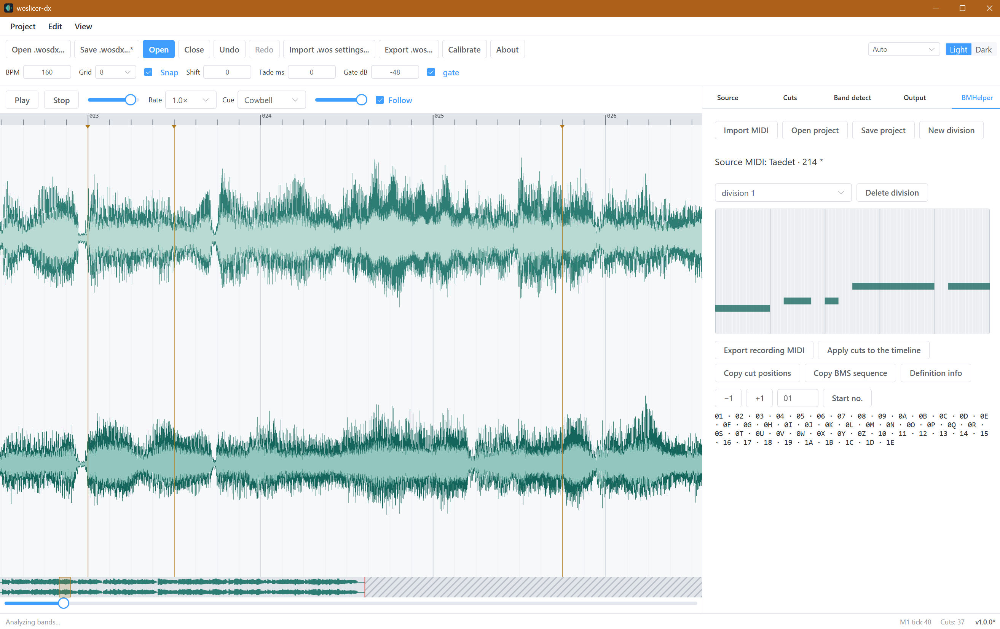

# woslicer-dx

[English](README.md) · [中文](README.zh-CN.md) · **日本語** · [한국어](README.ko.md)

wosderge の woslicerIII をベースにした、BMS 向けのオフライン音声スライサー。

> **[Web 版を開く](https://woslicer-dx.pages.dev/)** · インストール不要。音声は端末内で処理します。

## 機能

- WAV と OGG の読み込み、WAV スライスの書き出し。音源情報には元の形式を表示します。現在の音声処理と WAV 出力は 16-bit PCM です。
- `.wosdx` プロジェクトを保存し、再び開けます。旧形式 `.wos` の設定を読み込み、書き出せます。BMSE とはクリップボードで切断位置を交換できます。
- スナップ、範囲選択、クオンタイズ、元に戻す／やり直しを備えたタイムライン編集。
- 再生速度を変えたモニタリング、キュー音、タップ補正。
- 周波数帯域の表示と自動カット検出。
- 内蔵 BMHelper は、鍵盤音用 MIDI パートを録音シーケンスと WAVE 定義に分割します。その切断位置をタイムラインに適用できます。
- オリジナルの BMHelper beta 4′ の `.bmh` ファイルを読み書きできます。DX プロジェクトは Unicode の分割名を保持します。BMH 出力では原版の CP932 文字置換を適用し、名前が変わる場合は警告を表示します。
- 英語・中国語・日本語・韓国語の UI。「About」にバージョン、コミット、ビルド日時を表示。

## 実行

Releases または Actions の成果物から、ご利用のシステム向けパッケージをダウンロードします。

| プラットフォーム | 形式 | 使い方 |
| --- | --- | --- |
| Windows | .zip | ZIP を展開して起動。WebView2 が必要 |
| Linux | .deb / .AppImage | deb をインストール、または AppImage を実行 |
| macOS | .dmg | ディスクイメージを開き、アプリを「アプリケーション」にドラッグ |
| Web | .zip | 展開して静的サイトとして配信 |

Windows x64 が主要なデスクトップ版です。ほかの Windows アーキテクチャ、Linux、macOS 向けのパッケージは利用可能な場合に提供します。本アプリはファイルをローカルで処理し、オフラインで動作します。

## 操作

デスクトップ版のプロジェクトは音声の絶対パスを保存し、開くときに利用可能なファイルを自動で再接続します。ファイルを移動した場合は「音声を再リンク」を使ってください。ブラウザー版では手動での再リンクが必要です。セッションの復元中や音声の読み込み中は、作業領域の上部に現在の処理を表示します。

**ヘルプ → 使い方とショートカット** で、操作手順、マウス操作、キー一覧、キャリブレーション方法を確認できます。ヘルプはオフラインで利用できます。

## プロジェクト情報

[変更履歴](CHANGELOG.md) · [開発ガイド（英語）](docs/DEVELOPMENT.md)

## ライセンスとクレジット

[MIT](LICENSE) · [クレジット](NOTICE)
