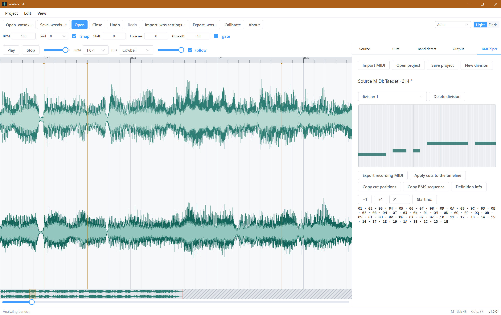

# woslicer-dx

[English](README.md) · [中文](README.zh-CN.md) · [日本語](README.ja.md) · **한국어**

wosderge의 woslicerIII를 기반으로 만든 BMS용 오프라인 음원 분할 도구.

> **[웹 버전 열기](https://woslicer-dx.pages.dev/)** · 설치 불필요. 음원은 기기 내에서 처리.

## 기능

- WAV, AIFF, FLAC, Ogg Vorbis, MP3, AAC-LC, ALAC 불러오기. MKV/MKA 내부의 지원 형식 오디오도 읽기 가능. 내부 처리는 Float32, 구간별 WAV 출력은 16-bit PCM 사용.
- `.wosdx` 프로젝트 저장·열기, 기존 `.wos` 설정 가져오기·내보내기. 클립보드로 BMSE와 분할점 교환.
- 스냅, 범위 선택, 퀀타이즈, 실행 취소/다시 실행을 지원하는 시간축 편집.
- 배속 미리 듣기, 알림음, 입력 타이밍 보정.
- 키보드, Xbox, YuanCon 컨트롤러로 분할점 기록. 키 번호와 동시 입력을 `.wosdx`에 저장.
- 명령 휠로 자주 쓰는 명령 실행. 컨트롤러는 LT, 키보드는 R을 길게 누름.
- 주파수 대역 표시와 분할점 자동 검출.
- 내장 BMHelper로 건반음 MIDI 파트를 녹음 시퀀스와 WAVE 정의로 분할. 분할점을 시간축에 적용 가능.
- 원본 BMHelper beta 4′의 `.bmh` 파일 읽기·저장 지원. DX 프로젝트는 Unicode 분할 이름 보존. BMH 내보내기 시 원본의 CP932 문자 대체 규칙을 적용하며, 이름이 바뀌면 경고 표시.
- 영어·중국어·일본어·한국어 UI. ‘버전 정보’에 버전, 커밋, 빌드 날짜 표시.

## 실행

[Releases](https://github.com/gumi-conqueror/woslicer-dx/releases) 또는 [Actions 빌드 결과](https://github.com/gumi-conqueror/woslicer-dx/actions/workflows/build.yml)에서 운영 체제에 맞는 패키지 다운로드.

| 플랫폼 | 형식 | 사용 방법 |
| --- | --- | --- |
| Windows | .zip | ZIP을 풀고 실행. WebView2 필요 |
| Linux | .deb / .AppImage | deb 설치 또는 AppImage 실행 |
| macOS | .dmg | 디스크 이미지를 열고 앱을 응용 프로그램 폴더로 드래그 |
| Web | .zip | 압축을 풀고 정적 웹사이트로 호스팅 |

기본 데스크톱 버전은 Windows x64. 다른 Windows 아키텍처와 Linux·macOS 패키지는 제공 가능한 경우 포함. 파일은 기기 내에서 처리하며 오프라인으로 동작한다.

## 조작

데스크톱 프로젝트는 음원의 절대 경로를 저장하고 열 때 사용 가능한 파일을 자동으로 다시 연결한다. 파일을 이동한 경우 ‘음원 다시 연결’ 사용. 브라우저에서는 직접 다시 연결해야 한다. 작업 복원이나 음원 불러오기 중에는 작업 영역 상단에 진행 상태 표시.

**도움말 → 사용법 및 단축키**에 작업 순서, 마우스 조작, 단축키, 입력 보정 방법 수록. 오프라인에서도 확인 가능.

## 프로젝트 정보

[변경 내역](CHANGELOG.md) · [개발 문서(영어)](docs/README.md) · [개발 참여(영어)](CONTRIBUTING.md)

## 라이선스 및 제작 정보

[MIT](LICENSE) · [제작 및 사용 소프트웨어](NOTICE)
