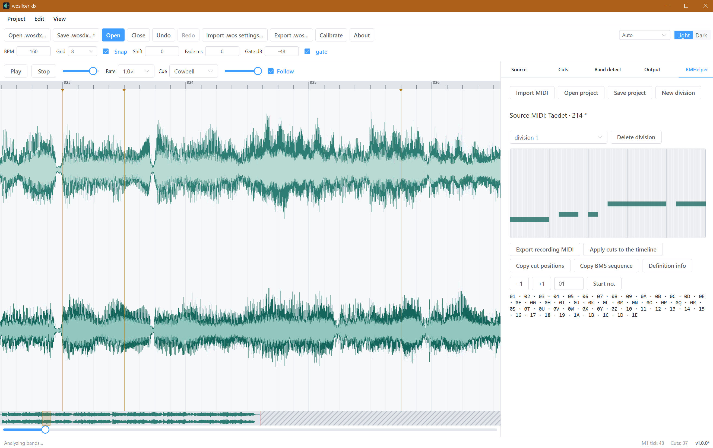

# woslicer-dx

**English** · [中文](README.zh-CN.md) · [日本語](README.ja.md) · [한국어](README.ko.md)

An offline audio slicer for BMS, based on wosderge's woslicerIII.

> **[Open the web app](https://woslicer-dx.pages.dev/)** · No installation. Audio stays on your device.

## Features

- Import WAV, AIFF, FLAC, Ogg Vorbis, MP3, AAC-LC and ALAC. MKV/MKA accepts supported audio codecs. Processing uses Float32; WAV slices use 16-bit PCM.
- Save and reopen `.wosdx` projects. Import or export legacy `.wos` settings and exchange markers with BMSE.
- Timeline editing with snapping, selection, quantization and undo/redo.
- Variable-speed playback, cue sounds and tap calibration.
- Frequency-band display and automatic marker detection.
- Built-in BMHelper divides key-sound MIDI into a recording sequence with WAVE definitions. Apply its markers to the timeline.
- Open and save original BMHelper beta 4′ `.bmh` files. DX projects preserve Unicode division names. BMH export uses the original CP932 character substitutions and warns when names change.
- English, Chinese, Japanese and Korean UI. About shows the version, commit and build date.

## Run

Download the package for your system from Releases or Actions artifacts:

| Platform | Package | Usage |
| --- | --- | --- |
| Windows | .zip | Extract the ZIP. Run the app. WebView2 is required. |
| Linux | .deb / .AppImage | Install the deb or run the AppImage |
| macOS | .dmg | Open the disk image. Drag the app to Applications. |
| Web | .zip | Extract the ZIP. Serve the files as a static website. |

Windows x64 is the primary desktop package. Other Windows architectures, Linux and macOS packages are included when available. The application processes files locally and works offline.

## Controls

Desktop projects store absolute audio paths and relink available files when opened. Use **Relink audio** after moving a file. The web app requires manual relinking. The workspace shows recovery and audio loading progress.

Open **Help → User guide and shortcuts** for editing steps, mouse controls, shortcuts and tap calibration. Help works offline.

## Project links

[Changelog](CHANGELOG.md) · [Development guide](docs/DEVELOPMENT.md)

## License and credits

[MIT](LICENSE) · [Credits](NOTICE)
